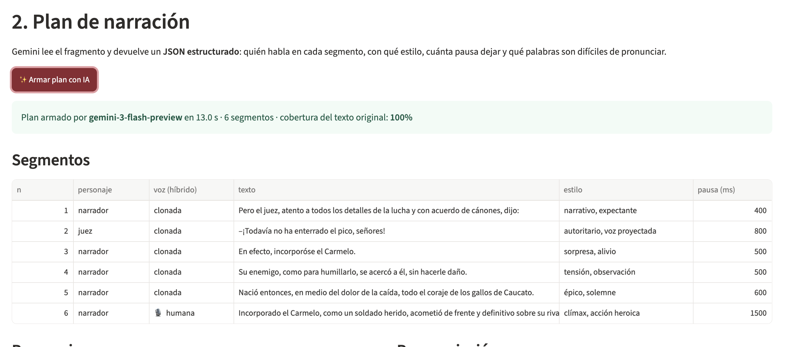
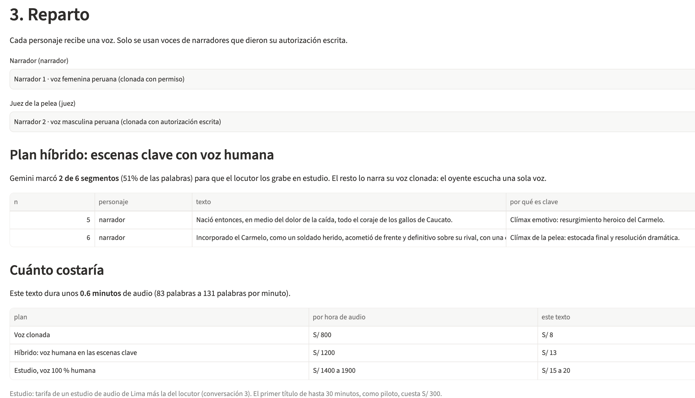
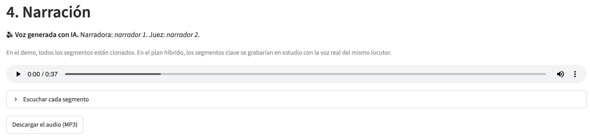
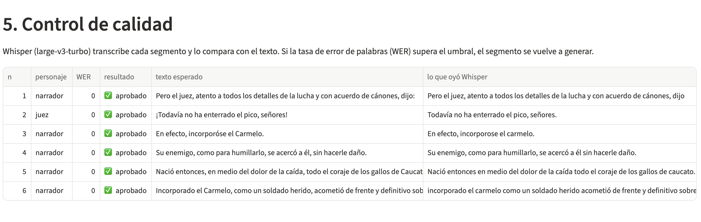
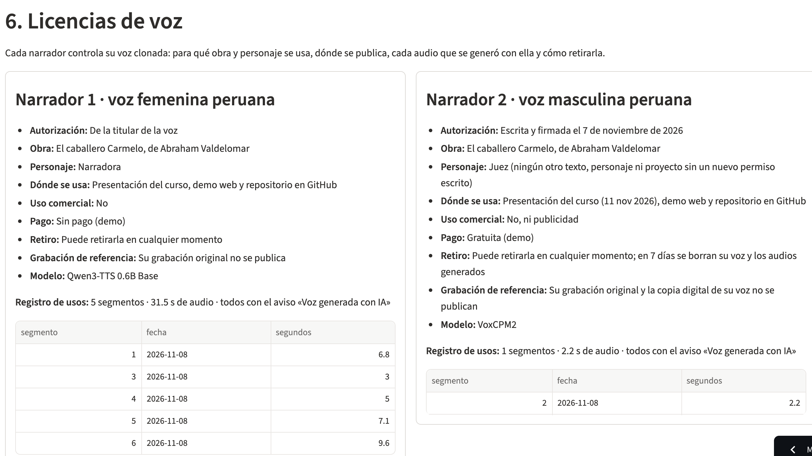
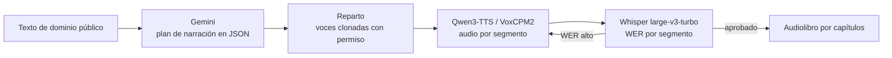

# Quriosa

> Quriosa convierte los libros infantiles y juveniles de las editoriales escolares peruanas en audiolibros narrados con voces peruanas replicadas con permiso.

**Demo:** https://quriosa.streamlit.app/

## Founder


**Susan Montalvo.** Desarrollo productos editoriales digitales y sistemas de metadatos mediante el uso de inteligencia editorial y datos abiertos.

Por eso conozco desde dentro quién produce audiolibros en el Perú y cómo circulan: el análisis de mercado de Quriosa parte de los registros ISBN de la Biblioteca Nacional.

Cubro producto, ingeniería, diseño y ventas con agentes de IA: Claude Code como socio técnico (código, despliegue y documentación), Gemini para el plan de narración y modelos abiertos de voz para la narración. Detalle en [Qué hizo el agente](#qué-hizo-el-agente).

<br clear="left">

## Problema

**Quién lo sufre:** las editoriales escolares peruanas que publican literatura infantil y juvenil para el plan lector. Son pocas y concentran el mercado: Santillana registró la mitad de los 447 audiolibros con ISBN del Perú entre 2015 y 2025, y el 57 % de esos audiolibros es para niños y jóvenes ([análisis](docs/mercado/04-panorama-mercado-audiolibros.md)).

**Cuánto les cuesta:** producir un audiolibro hoy exige estudio de grabación, un narrador por horas, dirección y edición. Un estudio de audio de Lima cobra S/ 150 (unos US$ 41) por hora de grabación con operador y lo mismo por hora de edición. Editar una sola voz toma el doble del tiempo de grabación, y una ficción sonora con varios personajes, el cuádruple o más. El locutor cobra aparte: de 100 a 250 dólares por hora, según su experiencia (tarifa referencial de la asociación de locutores, [conversación 3](docs/research/conversacion-3.md)).

**Cuánto paga hoy una editorial por un audiolibro grabado en estudio**, con el desglose de *El caballero Carmelo* (unos 27 minutos de audio; se asume 1 hora de estudio y la tarifa del locutor por hora terminada; soles a dólares a S/ 3.7 por dólar):

| | Voz 100 % humana: el locutor graba todo el libro | Ficción sonora 100 % humana: varios actores graban |
|---|---|---|
| **Por hora de audio terminado** | **US$ 370 a 520** | **US$ 550 a 700 o más** |
| ***El caballero Carmelo* (27 min)** | **US$ 167 a 234** | **US$ 248 a 315 o más** |
| Estudio y operador | US$ 41 (1 h) | US$ 41 (1 h) |
| Edición | US$ 81 (2 h) | US$ 162 o más (4 h o más) |
| Locutor | US$ 45 a 112 | US$ 45 a 112 por cada actor |
| Horas de trabajo de personas | 3 h | 5 h o más |
| Agenda | Locutor, operador y estudio el mismo día | Cada actor, operador y estudio |

**Cómo lo resuelven hoy:** graban con narradores en estudio, lo que limita el catálogo a pocos títulos, o no producen la versión en audio. En once años solo se registraron 447 audiolibros en todo el país, y uno solo en lengua originaria.

**Evidencia:** notas de 3 conversaciones en [docs/research/](docs/research/).
- [Conversación 1](docs/research/conversacion-1.md), editor de literatura infantil y juvenil con más de 10 años en el sector: no tiene audiolibros ni planea producirlos a corto plazo; prefiere la narración 100 % humana porque usa la IA solo en tareas mecánicas, no creativas. Conclusión: la narración sola no basta; la editorial valora un servicio completo con distribución y analítica de ventas e impacto (ello se tomará en cuenta para una siguiente etapa del proyecto). Sobre la voz con IA, Quriosa debe reforzar el mensaje de que usa voces de narradores reales que autorizaron su uso y dejar la opción de la narración humana al 100%.
- [Conversación 2](docs/research/conversacion-2.md), especialista en gestión curricular con más de 15 años en educación: no usa audiolibros ni siente el problema; le preocupan la conectividad, los derechos de autor y escuchar una voz generada por IA. Conclusión: falta familiarización con el uso de IA en la industria del libro; el audio debe poder descargarse para escucharse sin conexión.
- [Conversación 3](docs/research/conversacion-3.md), locutor con 25 años de experiencia que graba audiolibros para una editorial grande: cobra de 100 a 250 dólares por hora (tarifa referencial de la asociación de locutores), no graba más de 2 horas al día para no gastar la voz y tarda de 5 a 8 días por libro de 300 a 400 páginas. Rechaza la voz con IA porque ha visto textos que «suenan completamente falsos», y no licenciaría su voz: «No lo haría», porque hay voces licenciadas para una cosa que terminan en otras. Conclusión: el límite físico de la voz humana es real, pero los narradores ven la clonación como un riesgo; una licencia solo es viable con control verificable (una obra por contrato, plazo, registro de cada uso y derecho a retirarla).

## Solución e insight

**Qué construimos:** un flujo que convierte un texto en un audiolibro con varias voces.

1. **Plan de narración.** Gemini lee el fragmento y devuelve un JSON estructurado: quién habla en cada segmento, con qué estilo y pausas, qué palabras son difíciles de pronunciar y qué posibles erratas tiene el texto. También califica de 1 a 5 la importancia de cada segmento; la app elige los más importantes, hasta cerca del 30 % del texto, para grabarlos con voz humana en el plan híbrido.
2. **Reparto.** Cada personaje recibe una voz peruana clonada con autorización escrita del narrador.
3. **Narración.** Qwen3-TTS y VoxCPM2 generan el audio con esas voces; VoxCPM2 acepta indicaciones de estilo por frase, útiles para los personajes.
4. **Control de calidad.** Whisper transcribe cada segmento, mide el error (WER) y regenera los que salen mal.
5. **Licencia y registro de usos.** Cada voz tiene una licencia con la obra, el personaje, dónde se usa y cómo retirarla, y cada audio generado con ella queda registrado.

**Insight:** Clonar una voz ya es barato; lo escaso es la confianza. Las tres conversaciones rechazan la voz con IA; el locutor da una explicación: voces licenciadas para una obra terminan apareciendo en otras, sin que el narrador pueda controlarlo. A la vez, la voz humana tiene un límite físico: un locutor no graba más de 2 horas al día. Quriosa no compite con el narrador, sino que le da control sobre su voz clonada: cada licencia vale para una obra y un plazo, cada audio generado queda registrado con la obra y el pago, y el narrador puede retirar su voz. La IA hace la parte mecánica (plan de narración, pronunciación y control de calidad), que es donde la editorial ya la acepta; la voz sigue siendo la de un narrador real que autorizó cada uso, como el narrador 2 en el demo.

## Why now

- **Clonar una voz ya no exige horas de grabación ni un servicio de pago.** Modelos abiertos con licencia Apache 2.0, como Qwen3-TTS y VoxCPM2, clonan una voz con 10 a 25 segundos de audio y corren en una laptop sin GPU.
- **Los modelos de lenguaje devuelven datos estructurados confiables.** Un JSON con segmentos, estilos y pronunciación, validado contra un esquema, reemplaza horas de marcado manual del guion de narración. Y en el nivel gratuito de Gemini cuesta cero.
- **El mercado crece.** Las ventas de audiolibros en español crecieron 11.5 % en 2025, más que el ebook (1.5 %) y el libro impreso (3.8 %), según el informe anual de Bookwire ([resumen](docs/mercado/04-panorama-mercado-audiolibros.md#canales-principales)), y desde 2024 el Ministerio de Cultura publica audiolibros de cuentos y poemas peruanos.

## Demo

**URL:** https://quriosa.streamlit.app/. Escena de ejemplo: capítulo V de *El caballero Carmelo*, de Abraham Valdelomar (dominio público), con dos voces clonadas con permiso: la narradora (narrador 1) y el juez (narrador 2).

**1. Plan de narración:** Gemini divide el texto en segmentos por personaje, con estilo y pausas, y califica la importancia de cada uno; la app marca los que grabaría el locutor en el plan híbrido.



**2. Reparto, plan híbrido y precio:** cada personaje recibe una voz clonada con permiso; la app muestra las escenas clave para voz humana y cuánto costaría el texto con voz clonada, con el plan híbrido y en estudio.



**3. Narración:** el audio de la escena lleva el aviso «Voz generada con IA»; todos sus segmentos están clonados. Debajo, para el plan híbrido, la app compara el clímax grabado por el narrador 1 y generado con su voz clonada, y reproduce la escena completa en versión híbrida: segmentos 1 a 5 clonados y segmento 6 grabado.



**4. Control de calidad:** Whisper transcribe cada segmento y mide el error (WER); los 6 segmentos salieron aprobados.



**5. Licencias de voz:** cada narrador ve para qué obra se usa su voz, dónde se publica, cada audio generado y cómo retirarla.



**Qué pasa en vivo y qué está pregenerado:** el plan de narración se arma en vivo con Gemini para cualquier texto. El audio de la escena está pregenerado, porque en CPU generar 38 segundos de audio toma de 13 a 50 minutos, según el modelo. La versión híbrida se armó con los mismos segmentos clonados, con el ruido de fondo reducido, y el segmento 6 grabado por el narrador 1.



**Modelos y por qué:**

| Paso | Modelo | Por qué |
|---|---|---|
| Plan de narración | Gemini 3.5 Flash (y cuatro modelos de respaldo) | Salida JSON con esquema; nivel gratuito. Si ningún modelo responde en 60 s, la app muestra el plan pregenerado. |
| Voz de la narradora | Qwen3-TTS 0.6B Base | Clona con 10-25 s de audio, Apache 2.0, corre en CPU. |
| Voz del juez | VoxCPM2 | Clona y acepta un estilo por frase («árbitro firme, gritando a toda la cancha»). |
| Control de calidad | Whisper large-v3-turbo (faster-whisper) | Transcribe en la laptop, sin enviar el audio fuera; el WER detecta palabras mal dichas. |
| Reducción de ruido (escena híbrida) | RNNoise (filtro `arnndn` de ffmpeg, modelo std) | Acerca el fondo de los segmentos clonados al de la voz grabada; corre en la laptop, sin enviar el audio fuera. |

**Cómo correrlo:**

```bash
pip install -r requirements.txt
cp .env.example .env          # y pega tu GEMINI_API_KEY
streamlit run app/app.py
```

Generar audio nuevo (necesita torch, Qwen3-TTS, VoxCPM2 y faster-whisper; las voces de referencia no se publican):

```bash
python backend/narrar.py data/plan-narracion-carmelo-cap5.json --motor qwen
```

## Modelo de negocio

**Quién paga:** la editorial escolar. El Ministerio de Cultura es un cliente secundario.

| Plan | Qué incluye | Precio |
|---|---|---|
| Por título, voz clonada | Plan de narración, voces con licencia, control de calidad y revisión humana | US$ 220 por hora terminada. El primer título de hasta 30 min, como piloto: US$ 80 |
| Colección del plan lector | Hasta 12 horas al año con voz de IA (supuesto: unos 26 cuentos como *El caballero Carmelo*, 1 hora de audio al mes) | US$ 2300 al año (unos US$ 190 por hora, 13 % menos a cambio del compromiso anual) |
| Híbrido: voz humana en las escenas clave | El locutor graba en estudio cerca del 30 % del libro (las escenas que Gemini califica como más importantes, como el clímax; la app limita la selección a cerca del 30 % de las palabras) y su voz clonada narra el resto; el oyente escucha una sola voz | ≈ US$ 320 por hora terminada |

La narración 100 % humana en estudio se cotiza aparte. El híbrido cuesta de 14 % a 38 % menos que el estudio (≈ US$ 144 por *El caballero Carmelo*), con un margen de 16 % a 30 % para Quriosa; se vende por calidad, no por precio. Propuesta sin validar con editoriales; el cambio entre voz grabada y clonada puede notarse; el demo incluye la escena completa en versión híbrida (el clímax grabado por el narrador 1 y el resto con su voz clonada) y, aun con la reducción de ruido, la voz grabada suena más limpia. Para que suenen igual desde el principio, la voz de referencia del clon y las escenas clave deben grabarse en la misma sesión, con el mismo micrófono y en el mismo estudio.

El narrador recibe el 30 % de cada título narrado con su voz. El locutor de la conversación 3 no licenciaría su voz; sin embargo, el narrador 2 aceptó para una obra y sin uso comercial. Quriosa responde a la desconfianza del locutor con la licencia de voz: el locutor decide para qué obra y personaje se usa su voz y por cuánto tiempo, ve cada audio generado con ella y puede retirarla, como se ve en la sección 6 del demo ([captura](docs/capturas/5-licencias-de-voz.png)).

**Comparación con *El caballero Carmelo*:** hoy, en estudio con voz 100 % humana, cuesta de US$ 167 a 234 y 3 horas de trabajo de personas (ver [Problema](#problema)). Con Quriosa y la voz clonada de un locutor que licenció su voz, cuesta **US$ 99**, de 41 % a 58 % menos: incluye US$ 30 para el locutor, que grabó unos 20 segundos una sola vez, y alrededor de 1 hora de revisión humana, sin estudio ni agenda.

**Referencia:** grabar con una persona cuesta en España unos 289 € por hora terminada ([Agencia Podcast](https://agenciapodcast.com/el-precio-o-el-coste-del-audio/)) y entre 349 y 499 € en un servicio comercial ([BoD](https://www.bod.com.es/servicios/audiolibro)); en EE. UU., entre 100 y 400 dólares solo la locución ([Scuadra Digital](https://scuadradigital.com/como-se-cobra-un-audiolibro/)). Unos US$ 320 a 540 por hora. En Lima, entre el estudio de audio y el locutor, unos US$ 370 a 700 o más por hora terminada (ver [Problema](#problema)). Con voz de IA, Quriosa cuesta de 41 % a 69 % menos.

**Cuánto cuesta cada título (medido con el demo):**
- **Plan de narración:** la escena de 83 palabras usó 3766 tokens de Gemini. El cuento completo (3556 palabras, unos 27 minutos de audio) usaría unos 160 000 tokens: US$ 0 en el nivel gratuito. Con plan de pago (Gemini 3.5 Flash a US$ 1.50 por millón de tokens de entrada y US$ 9 por millón de salida, según agregadores), unos US$ 3 por hora terminada.
- **Voz:** en la laptop (CPU), Qwen3-TTS tarda unos 17 minutos por cada minuto de audio: el cuento completo tomaría unas 8 horas. Supuesto: unos US$ 1.35 (S/ 5) por hora terminada en un servidor con GPU (alquiler por horas de un servidor en la nube; Qwen3-TTS, VoxCPM2 y Whisper son modelos abiertos y gratuitos).
- **Revisión humana:** supuesto de 1 hora para *El caballero Carmelo* (unas 2 horas por cada hora de audio), a unos US$ 41 por hora (S/ 150, tarifa de edición del estudio de Lima). Whisper marca qué frases revisar, así que no hace falta escuchar todo el audio.

**Margen de contribución con *El caballero Carmelo*** (27 minutos, plan por título con voz de IA):

| | Dólares |
|---|---|
| Precio (US$ 220 por hora × 0.45 h) | 99.0 |
| Narrador (30 %) | − 29.7 |
| Gemini (plan de pago) | − 1.4 |
| Servidor con GPU | − 0.6 |
| **Margen antes de la revisión** | **67.3 (68 %)** |
| Revisión humana (1 h × US$ 40.5) | − 40.5 |
| **Margen final** | **26.8 (27 %)** |

La revisión humana es el costo más grande. Para que el margen crezca, la revisión debe tomar menos tiempo (solo las frases que marca Whisper) o hacerla la editorial, que ya revisa sus libros.

## Herramientas del curso

| Herramienta | Sesión | Dónde está | Por qué |
|---|---|---|---|
| LLM con salidas estructuradas | 08 | [app/app.py](app/app.py) (`armar_plan`, `ESQUEMA`), [ai/plan_narracion.md](ai/plan_narracion.md) | Convierte el texto en un plan de narración que el resto del flujo puede leer sin intervención humana. |
| Del texto a tu voz | 15 | [backend/narrar.py](backend/narrar.py) | Clona voces peruanas autorizadas y narra cada segmento con su estilo. |
| De la voz al texto con Whisper | 13 | [backend/narrar.py](backend/narrar.py) (`whisper`, `wer`) | Control de calidad automático: detecta y regenera frases mal pronunciadas. También transcribió las notas de voz de las conversaciones 1 y 3. |
| Despliegue de productos de datos | 12 | [app/](app/) en Streamlit Community Cloud | Demo público en https://quriosa.streamlit.app/. |

## Qué hizo el agente

Claude Code fue el socio técnico del proyecto. Susan definió el producto, el cliente, la escena, las voces y aprobó cada texto; Claude Code:

- **Mercado:** analizó la base de ISBN de la BNP ([notebooks/01_mercado_peruano.py](notebooks/01_mercado_peruano.py)) y resumió el informe de Bookwire ([docs/mercado/](docs/mercado/)).
- **Plan de narración:** escribió el prompt ([ai/plan_narracion.md](ai/plan_narracion.md)), el esquema JSON y el plan de la escena ([data/plan-narracion-carmelo-cap5.json](data/plan-narracion-carmelo-cap5.json)).
- **Voz:** escribió [backend/narrar.py](backend/narrar.py) (clonación con Qwen3-TTS y VoxCPM2, control con Whisper), instaló los modelos en una Mac Intel sin GPU y generó y mezcló el audio del demo. Para el plan híbrido, comparó las tomas grabadas por el narrador 1 (WER, ruido de fondo y tono), redujo el ruido de los segmentos clonados con RNNoise y armó la escena híbrida.
- **App:** escribió [app/app.py](app/app.py), probó qué modelos de Gemini respondían y armó el respaldo, agregó las licencias de voz, las escenas clave del plan híbrido (Gemini califica la importancia y la app controla que no pasen del 30 % del texto) y la calculadora de precios, vectorizó el logo y guió el despliegue en Streamlit Community Cloud.
- **Research:** propuso plantillas de las conversaciones, que Susan editó y actualizó, y la autorización de uso de voz que firmó el narrador 2. Transcribió con Whisper las notas de voz de las conversaciones 1 y 3, quitó los nombres y resumió lo aprendido.
- **Documentación:** este README, con los textos validados por Susan.

## Ética y consentimiento

- Solo se clonan voces con autorización escrita. El narrador 2 autorizó el uso de su voz solo para el juez de *El caballero Carmelo*, en la presentación, el demo web y GitHub, sin uso comercial. Su audio de referencia no se publica.
- Todo audio lleva el aviso «Voz generada con IA».
- Solo se usan obras de dominio público (Valdelomar murió en 1919).
- Las voces se identifican como narrador 1 y narrador 2, sin nombres.

## Estructura del repositorio

| Carpeta | Contenido |
|---|---|
| app/ | App de Streamlit, audio del demo, licencias de voz y logo |
| backend/ | narrar.py: plan → voces clonadas → control de calidad → escena |
| ai/ | Prompt del plan de narración |
| data/ | Texto de la obra, plan de la escena y base de ISBN de la BNP |
| docs/ | research/ (3 conversaciones), mercado/ (análisis de mercado), capturas/ (capturas de la app) y foto del founder |
| notebooks/ | Análisis del mercado peruano |

## Licencia

MIT. Ver [LICENSE](LICENSE).
